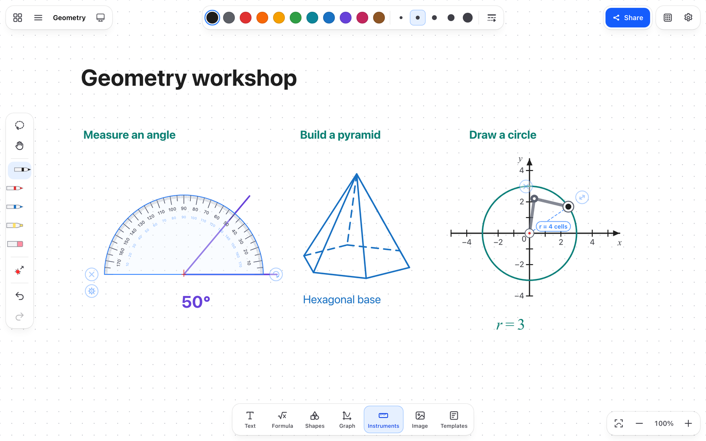

**Penrill** is a free infinite whiteboard for pen tablets.

## Image exports and Apple Pencil in 0.13.8

- PNG exports and board thumbnails finish even when a picture on the board cannot load.
- Open boards redraw as their pictures load.
- On iPad, short Apple Pencil strokes keep their final point. Late pointer events from an earlier stroke no longer cut the next stroke short.

## Editor dialogs and Apple Pencil in 0.13.7

- The iPad drawing prompt opens after lifting the pen from the board. Dismissing it leaves your preference undecided for the next visit.
- Keyboard and clipboard actions in dialogs leave the board behind them alone. Escape closes the shortcuts and coordinate settings dialogs.
- Escape closes the selection's style menu while keeping the stroke selected. Settings tabs follow the visible layout when navigating with arrow keys.
- If the browser cannot copy a board link, Penrill selects the link so you can copy it manually.

## About credits in 0.13.6

- Settings → About now credits Penrill in both English and Ukrainian.

## Shared boards and browser updates in 0.13.5

- Choose paper or chalkboard on your own device. Everyone on a shared board still sees the same ruling.
- Slanted copybook paper keeps the handwriting rows and adds widely spaced guides, including in exports.
- On mobile and desktop browsers, open Settings → About to check for updates. Reload when ready and return to the same board after saving.
- About now includes the project website and creator credits.

## Finger drawing on iPad in 0.13.4

- Draw with a finger as soon as you open a board. Use two fingers to pan and zoom.
- After your first Pencil contact, choose whether one finger draws or moves the board. The recommended Pencil-only mode keeps one finger free for panning.
- Penrill remembers your choice in this browser. You can change it in pen settings.

## Pen input and board sharing in 0.13.3

- iPad pens, including Apple Pencil, use the pressure reported by the browser. Tilting the pen keeps the same width at the same pressure.
- In Settings, you can turn pressure sensitivity off independently for iPad pens and for Wacom and other pen tablets.
- Lifting the pen on a tool in the drawing rail selects it immediately, including when the browser skips the click event.
- The board sharing dialog asks for the person to invite and disables autocomplete on the recipient field.

## Pen input in 0.13.2

- **Wacom tablets.** A stroke now filters out old hover positions that could draw a stray line from the centre of the screen.
- **Apple Pencil.** Drawing continues through brief contact-signal gaps, even if your palm landed first. On supported devices, tilting the Pencil makes light strokes wider.

## Penrill Cloud

- **Sync with Penrill Cloud.** On the *Sync* page choose **Penrill Cloud**, sign up or sign in in the browser,
  and your boards follow you to every computer and to the web app. Share a board with people by username
  or with a draw link that needs no account.
- **The web app moved to [app.penrill.com](https://app.penrill.com/).** There you can also open Penrill Cloud.
- **You decide whether a shared board can be copied.** In *Share* turn on *Allow copying and export* to let
  people duplicate it, save it as a file, export it or copy things out of it. It is off for every board until you
  turn it on.
- **Stopping sharing takes the board away.** When you take someone off a board, or turn its link off, the board
  leaves their devices. When you delete a shared board, Penrill asks whether they keep a copy.
- **Smoother cursors and drawing of the people on a shared board.** Their cursors glide instead of jumping,
  and their lines grow evenly as they draw.

## Also in 0.12: Inkboard is now Penrill

- **New name, same app.** Inkboard updates to Penrill by itself; your boards, templates and settings stay.
- **Board files are now `.penrill`.** Your `.inkboard` files still open, by double-click or with *Open*.
- **New website:** [penrill.com](https://penrill.com/), with the web app at [penrill.com/app](https://penrill.com/app/).

## A calmer board

- **Drawing tools on the left.** The pens, highlighter and eraser lie in a tray, and the one in use slides out. Select, the hand, the laser and undo / redo are on the same rail.
- **Colours and widths one tap away.** The strip at the top shows only what the tool in use can change.
- **Things to put on the board at the bottom, with their names:** text, formulas, shapes, graphs, drawing instruments, images and templates.
- **Settings in one window, in sections.** Under *Tools* you can hide buttons you don't use; their keys keep working.
- **Short tips that go away by themselves**, in the bottom-left corner, clear of the tools.

## A new home screen

- **Boards, templates and sync in one place.** A sidebar lists all boards, templates, recently deleted boards and your tags. Each card shows a preview, when the board was last edited, its tags and where it syncs to.
- **Start from a template:** click a template to get a new board with it already on it.
- **Sync on its own page:** choose this device, Penrill Cloud or your own server, and sign in there.
- **Every board has its own address** in the web app (`penrill.com/app/board/…`), so reloading, bookmarks and the browser's Back button work.
- Achievements and easter eggs are removed.

## Also in 0.11.1

- **Sharp PDF exports:** the dots, grid and lines of the paper are now real vector shapes in the PDF.
  They stay crisp at any zoom instead of looking soft, and dots no longer smear into dashes.

## Also in 0.11.0

- **Turn anything:** select ink, shapes, pictures, text or formulas and drag the ↻ handle on the right
  of the frame. Hold Shift for 15° steps. Double-click the handle to turn it back upright.
- **Board colour on its own:** pick white paper or the green chalkboard in Background, whatever the
  interface theme. The chalkboard no longer needs the experimental switch.
- **Tidier Background picker:** blank, dots, grid and lines up front; math grid, handwriting and
  slanted rows under **More**.
- **Calmer drawing instruments:** the ruler, set squares, protractor and compass are see-through, with
  fainter single millimetres and degrees. Their buttons stay dim until you point at the instrument.
  On the chalkboard they use chalk colours.
- Angles read the way people count them: a turn down shows as −20°, not 340°.
- PNG and PDF exports are always on white paper, even from the chalkboard.
- **Refreshed interface:** settings in clear sections with switches, one consistent look for buttons and
  selected items, and a dark theme with better contrast.

Boards with turned pictures, text or formulas are saved as format version 10 and need version 0.11.0
or newer. Other boards still open in older versions.

## Also in 0.10.1

- The ruler, set squares, protractor and compass share one dropdown on the toolbar, with their keys shown.
- Toolbar buttons show the key that picks the tool.
- The mouse Back and Forward buttons undo and redo.
- Shorter, cleaner menus and settings: long hint texts are gone.
- The board redraws right away when the system switches between light and dark.

## Also in 0.10.0

- **Penrill in your browser:** [open the app](https://penrill.com/app/) with
  nothing to install. Boards are kept in the browser; you can save and open board files, export PNG,
  and print to PDF. It keeps working offline after the first visit.
- **Hold-to-snap shapes:** keep the pen still at the end of a stroke to turn a rough circle, oval, arc,
  rectangle, square or triangle into a clean one. Keep holding and drag to resize it; Shift or a finger
  on the screen makes it perfect. On/off and hold time in Settings → Board.
- **Point eraser** that cuts lines apart ("Only what it touches"), and an eraser size slider.
- **Laser pointer (L)** with a fading red trail that is never saved.
- **School paper:** math grid, handwriting rows and slanted copybook lines, on paper and chalkboard.
- Selected items are tinted and lifted off the board with a soft shadow.
- Bullet and numbered lists in text.
- Settings → Board → Mouse wheel: scroll or zoom.
- White is no longer in the pen palette; white ink already on boards loads as black (it still looks
  white on the chalkboard).
- New license: FSL-1.1-MIT (free to use, study and change for anything except a competing product;
  every release turns MIT after two years). Versions up to 0.9.2 stay under GPL-3.0-or-later.

Boards that use the school backgrounds are saved as format version 9 and need version 0.10.0 or newer.

## Also in 0.9.2

- Customize the toolbar by dragging tools into position or back into the palette.
- Add multiple dividers to organize tools into groups. Your layout is saved between launches.
- One top bar with horizontally scrolling tools keeps controls on a single row.
- Ruler, both set squares, protractor and compass have individual toolbar buttons.
- New shortcuts: R for ruler, S for the 45° set square, Shift+S for the 30° / 60° set square.
- The desktop board follows the interface theme, using a green chalkboard in dark mode.

## Also in 0.9.1

- A live demo on the website (replaced in 0.10.0 by the full app in the browser).

## Also in 0.9.0

- **Dark theme:** choose System, Light or Dark in Settings. Theme selection is available by default.
  The interface follows your system appearance unless you choose a theme yourself.
- **Refreshed interface:** updated toolbars, menus and board library with clearer spacing and colors.
- **Experimental chalkboard:** enable Chalkboard in Settings → Experimental features, then choose a
  green surface in Background. Dark ink is displayed in readable chalk colors without changing the
  stored vector data. Thumbnails and exports preserve the board's appearance.
- **Updated website:** new English and Ukrainian examples with screenshots that follow the site theme.

Chalkboard files use format version 8 and need version 0.9.0 or newer. Older boards remain readable;
boards without chalkboard surfaces continue to use the lowest compatible format version.

## Also in 0.8.0

- **Formulas on the board.** The new **√x** tool opens an on-screen math keypad: fractions, roots of any
  degree, powers and indices, logarithms, trigonometry, limits, derivatives, integrals, sums, matrices,
  combinations and Greek letters. Keys with a red dot have more variants (hold the key or right-click it):
  `∛`, `x³`, a free power. A formula stays vector; double-click it to edit.
- **Typing works too:** `/` divides, `Alt + /` makes a fraction, `^` a power, `_` an index;
  `sqrt`, `sin`, `pi` turn into their signs.
- **Show answer:** plain arithmetic gets a button that reveals its value, so the class can work it out
  first.
- **Plot formulas from the board:** select one or more formulas (`y = x²`, `f(x) = …`) and press the plot
  button to get a coordinate plane with their graphs.
- **More in the Functions panel:** any name and variable (`s(t) = 2t`), a range of `x` and of `y` for
  each curve, and equations such as the circle `x² + y² = 4` or `x = y²`.
- **Fit to graphs** sets a plane's axes to just hold its curves, growing or shrinking it.
- The bar above a selection is smaller and always stays on screen.

Boards with formulas, ranges or equations can't be opened by 0.7.2 or older, so update every computer you
use. Other boards still open there.

## Also in 0.7.2

- **Ruler and set squares:** all measuring and drawing instruments (ruler, 45° set square, 30°/60° set square,
  protractor and compass) now live in a dedicated **Drawing tools** menu on the toolbar. Draw with the pen
  along any edge of the ruler or set square for a straight segment measured in centimetres and millimetres
  (`1 cm = 2 paper cells`).
- **Grid snap for instruments:** hold `Ctrl` (`⌘` on macOS) while moving any instrument to snap its origin
  (the ruler's `0 cm` mark, the set square's `90°` corner, the protractor's centre or the compass's needle)
  to paper grid intersections.
- **New library storage:** boards, templates, tags and thumbnails now live in one local database, with each
  image stored once. Your boards move over automatically on first launch; the old files are kept in the
  `legacy-0.6` folder inside the library, nothing is deleted.
- **Every board lives in the app now.** *Save as file…* saves a copy you can send or keep. Opening a
  board file adds it to your boards once; opening the same file again opens that board.
- **Autosave** writes at most 5 seconds after you change something, even while you keep drawing.
- **Version history has been removed.**

Boards from 0.7 can't be seen by older versions, so update every computer you use.

## Also in 0.6.0

- **Function graphs:** Graph menu → *Function graph…*, or select a coordinate plane and click **Function**.
  Type formulas such as `x^2`, `2x + 1`, `sin(x)`, `sqrt(x)`, `|x|` or `1/x` (up to 8 per plane): the
  curves appear as you type, with the formula written next to each one as in a textbook.
- **The protractor follows the pointer:** the part under the pen lights up with a hint, the edge shows the
  degree you are pointing at, and arcs and rays snap to whole degrees. The new ⚙ handle sets the step
  (off, 1°, 5° or 15°).
- **The compass follows the pointer too:** lit parts and hints, cell marks on the radius, and arcs snap to
  quarter, half and full turns.
- **Narrow windows:** the top toolbar no longer covers the menu; it moves aside or to a second row.

Boards saved by 0.6 can't be opened by older versions, so update every computer you use.

## Also in 0.5.2

- **macOS:** the `.dmg` window now shows how to install Penrill and how to open it the first time.

## Also in 0.5.1

- **The Linux AppImage starts on Ubuntu 24.04 and newer** without installing anything extra
  (it used to need libfuse2).
- **Version history** saves a snapshot every 5 minutes of editing and keeps the last 36 (about three hours).
- **After restoring a version** the view moves to show the whole board, so it never looks empty.
- New boards are named like "Board of 11 Nov 2026, 18:30".
- Clearer wording in the interface (English and Ukrainian) and a fuller description of the `.deb` package.

## Also in 0.5.0

- **Compass (K):** set the radius, then drag the pencil around the needle for an arc or a full circle.
- Protractor arcs get their angle written next to them ("50°").
- **Formatted text:** select words (or right-click) → colour, size, **bold**, *italic*, underline.
  Double-click text to edit it.
- Any number of sides (3–24) for the base of a pyramid or prism.

Boards saved by 0.5 can't be opened by older versions, so update every computer you use.

## Also in 0.4

- Text, line end dragging, editable shapes, lock, brush select (C), arrows on freehand lines, 3D axes,
  replacing templates. Fix for the pen getting "stuck" moving the board.

## Download

| System | File |
|---|---|
| Windows | `Penrill-Setup-…-x64.exe` |
| macOS (Intel and Apple Silicon) | `Penrill-…-mac-universal.dmg` |
| Linux | `.AppImage` (any distro, auto-updates) or `.deb` (Ubuntu / Debian) |

## First launch

The builds are not code-signed yet, so the system will warn you once:

- **Windows:** "Windows protected your PC" → click **More info** → **Run anyway**.
- **macOS:** open the `.dmg`, drag Penrill to Applications and open it. macOS says it can't verify the app:
  click **Done**, open **System Settings → Privacy & Security**, scroll down and click **Open Anyway**.
  You only do this once.
- **Linux AppImage:** allow it to run (file Properties → *Executable as Program*, or `chmod +x Penrill-*.AppImage`) and open it.

Feedback and bug reports: open an issue in this repository.
