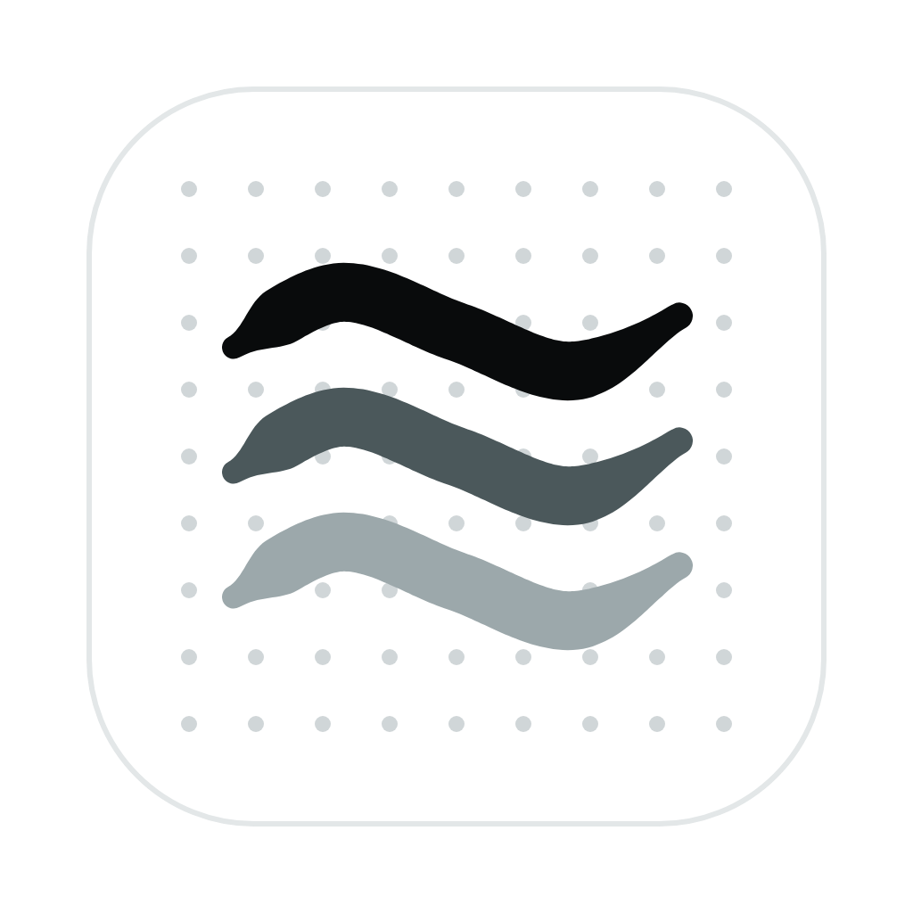
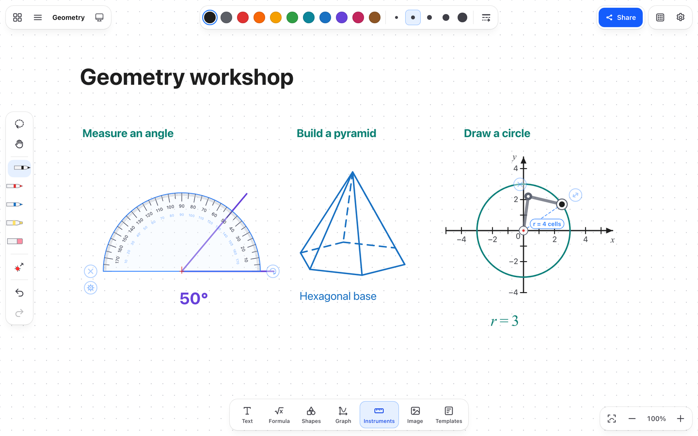
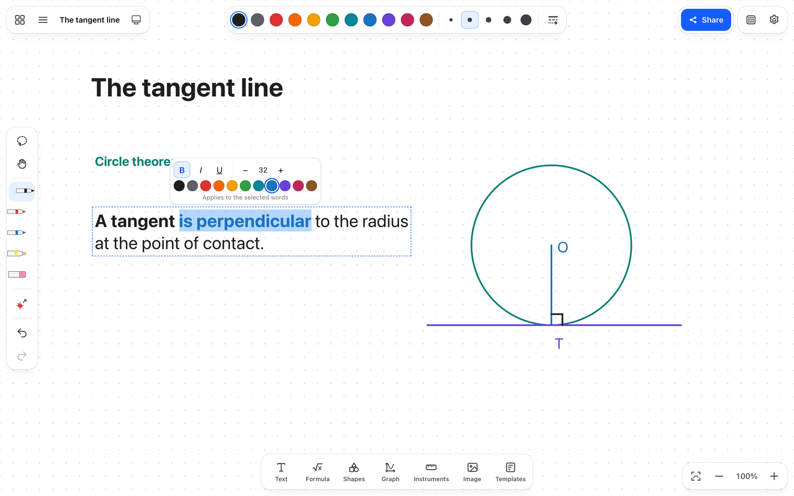
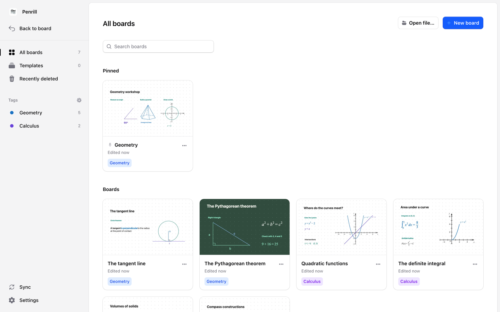

<div align="center">



# Penrill

**A free whiteboard for teachers who write and draw with a pen tablet.**<br>
Infinite board, pressure-sensitive vector ink, a protractor and a compass, shapes and coordinate axes for maths.

[](https://github.com/Penrill/penrill/releases/latest)
[](https://github.com/Penrill/penrill/releases)
[](https://github.com/Penrill/penrill/actions/workflows/ci.yml)
[](https://github.com/Penrill/penrill/actions/workflows/release.yml)
[](LICENSE)


[](https://github.com/Penrill/penrill/releases/latest)
[](https://github.com/Penrill/penrill/releases/latest)
[](https://github.com/Penrill/penrill/releases/latest)

[](https://snapcraft.io/inkboard)

**[Website](https://penrill.com/)** ·
**[Download](https://github.com/Penrill/penrill/releases/latest)** ·
**[What's new](CHANGELOG.md)** ·
**[Keyboard shortcuts](docs/SHORTCUTS.md)** ·
**[Українською](README.uk.md)**



</div>

## Why Penrill

Microsoft Whiteboard was the go-to board for many teachers with a pen tablet, and it's being retired.
Penrill aims to feel just as simple (open it and write) while adding the tools a maths or science
lesson needs. Local boards work offline without an account. Sign in to a specific server to sync and share there.

## Features

**Writing and drawing**
- Infinite board: pan and zoom in any direction
- Pressure-sensitive **vector** ink that stays sharp at any zoom
- Pens, highlighter, stroke eraser; the pen's eraser end and barrel button work too
- Pen hover indicator and palm rejection
- Paper: blank, dots, grid or lines

**For maths lessons**
- **Protractor:** draw an angle from its centre or an arc along its edge; the degrees are written next to the arc
- **Compass:** set the radius (shown in paper cells) and draw arcs or full circles
- Shapes: lines, polygons, circles, and pyramids / prisms with **any number of sides** for the base, still editable after drawing
- Number lines, coordinate planes and 3D axes; plot functions on a plane
- **Formulas** from an on-screen math keypad: fractions, roots, powers, integrals, matrices; plain arithmetic gets its result on a "Show answer" click, and functions and equations such as `x² + y² = 4` are plotted on a coordinate plane in one click (any name and variable, on a chosen range of x and y, with the axes fitted to the graphs)
- Shift for straight lines; drag a line's end to change its length and angle (whole degrees on the protractor)
- Arrows and dots on line ends, including freehand lines

**Text and pictures**
- Type right on the board; select words to change their colour, size, **bold**, *italic*, underline
- Paste pictures and screenshots (Ctrl+V), drag them in, or insert from a file

<p align="center"></p>

**Organising**
- Lasso and brush selection: move, scale, duplicate, group, lock
- Templates: save part of a board and reuse it in other lessons
- Home screen with all boards (previews, search, pins, colour tags such as a class or a subject),
  templates that start a new board, recently deleted boards and sync

<p align="center"></p>

**Never lose work**
- Every board saves itself within seconds, so nothing is lost even if the power goes out
- Version history, and *Recently deleted* for 30 days
- Optional backup folder (a USB stick or a Google Drive / OneDrive folder)
- Export to PNG or vector PDF; save a board as a `.penrill` file to share it

**And also**
- Automatic updates (Windows, Linux AppImage); a new-version notice on macOS
- English and Ukrainian interface
- Works with Wacom tablets, including side buttons and ExpressKeys ([see below](#wacom-tablets))

## Download and install

Get the latest version from the **[Releases page](https://github.com/Penrill/penrill/releases/latest)**:

| System | File | Notes |
|---|---|---|
| Windows 10 / 11 | `Penrill-Setup-…-x64.exe` | Windows may warn about an unknown publisher (the app isn't code-signed yet): **More info → Run anyway** |
| macOS (Intel and Apple silicon) | `Penrill-…-mac-universal.dmg` | Not notarized by Apple yet: if macOS blocks the first launch, open **System Settings → Privacy & Security → Open Anyway** |
| Ubuntu and other Linux with snaps | [Snap Store](https://snapcraft.io/inkboard) | Install from App Center (search for inkboard) or run `sudo snap install inkboard` |
| Linux | `Penrill-…-x86_64.AppImage` or `.deb` | AppImage: allow it to run (file Properties → *Executable as Program*, or `chmod +x`), then open it |

After that Penrill updates itself on Windows, with the AppImage and from the Snap Store; on macOS and with the `.deb` it tells you when a new version is out.

## Controls

| Action | Input |
|---|---|
| Draw | pen / left mouse button |
| Erase | eraser tool, pen eraser end, or pen barrel button |
| Pan | wheel / touchpad scroll, middle or right mouse drag, Space + drag, one finger |
| Zoom | Ctrl + wheel, touchpad pinch, two-finger pinch, Ctrl + / Ctrl − / Ctrl+0 |
| Tools | 1 / 2 / 3 pens, H highlighter, E eraser |
| Undo / Redo | Ctrl+Z / Ctrl+Y (Ctrl+Shift+Z) |
| Insert image | Ctrl+V, drag a file in, or *Image* at the bottom |
| Lasso select | V; Del deletes, Ctrl+D duplicates, Ctrl+C / Ctrl+V copy & paste |
| Brush select | C: touch items with the circle to add them; mouse wheel = circle size; Ctrl / Alt + drag removes |
| Straight line | hold Shift while drawing |
| Group / ungroup | Ctrl+G / Ctrl+Shift+G |
| Change a line's angle / length | select it (V or M) and drag one of its round end handles |
| Stretch a shape | select it and drag a side handle; *Shape* on the selection bar changes kind / base |
| Text | *Text* at the bottom: click and type, Esc when done; double-click text to edit; select words (or right-click) for colour / size / bold / italic / underline |
| Protractor | T: draw from the centre for an angle, along the edge for an arc (its degrees are written next to it) |
| Compass | K: drag ↔ to set the radius, then drag the pencil around the needle (a full turn = circle) |
| Lock / unlock | *Lock* on the selection bar |
| Move tool (drag anything) | M |
| Swap pen ↔ eraser | X |
| All boards | Ctrl+H |
| New board / Open file | Ctrl+N / Ctrl+O |
| Save as file | Ctrl+S (draft) or Ctrl+Shift+S |

The full list is in [docs/SHORTCUTS.md](docs/SHORTCUTS.md) and in the app (Settings → *Keyboard shortcuts*).

## Wacom tablets

- **Pen side buttons:** in Wacom Center set the lower switch to *Right click* and the upper to *Middle click*;
  then choose what each does in Penrill (Settings → Pen buttons: eraser, lasso, or the current tool).
  To move the board with a pen button, give it the *Space* keystroke instead (hold = move).
  The settings panel has a tester that shows which button Penrill receives.
- **ExpressKeys** on the tablet are configured in Wacom Center as *Keystroke…*, for example Ctrl+Z, X, V, M, Space.
  Settings → *Keyboard shortcuts & Wacom ExpressKeys* lists every shortcut.

## Where boards are stored

- Boards you never saved as a file live in the app's data folder
  (`%APPDATA%/Inkboard/Library` on Windows, `~/.config/Inkboard/Library` on Linux,
  `~/Library/Application Support/Inkboard/Library` on macOS; the folder keeps the app's former name).
- "Save as file…" turns a board into a normal `.penrill` file anywhere you like; it keeps
  autosaving into that file.
- Every write is crash-safe (temp file + fsync + atomic rename, previous version kept as `.bak`).

## Feedback

Found a bug or missing something for your lessons?
[Open an issue](https://github.com/Penrill/penrill/issues/new/choose) in English or Ukrainian.
See [CONTRIBUTING.md](CONTRIBUTING.md) if you'd like to help with code or translations.
The roadmap is in [docs/PLAN.md](docs/PLAN.md).

## Development

Built with Electron, React and TypeScript; the board is a custom Canvas 2D engine
(`src/board/engine` and the packages in `packages/`, see [docs/ARCHITECTURE.md](docs/ARCHITECTURE.md)).
Requires Node.js (LTS or newer).

```bash
npm install
npm run dev        # start the app with hot reload
npm run dev:x11    # Linux/Wayland: use this if pen pressure doesn't work
npm run dev:web    # the web version at http://localhost:5174/
npm run typecheck
npm test
npm run build
```

> npm 11+ may skip Electron's install script. If `npm run dev` says Electron failed to install,
> run `node node_modules/electron/install.js` once.

### Running with a sync server

Start [penrill-server](https://github.com/Penrill/penrill-server) (.NET 10 SDK) next to the web
version:

```bash
npm run dev:web
dotnet run --project ../penrill-server/src/Server    # in another terminal
```

1. Open [the library](http://localhost:5174/) and go to **Sync** in its sidebar
   ([localhost:5174/sync](http://localhost:5174/sync)). Select Self-hosted and enter the server origin, or select Local test cloud. Register or sign in on that instance.
2. Create a board and draw. Changes sync automatically to the selected service.
3. To draw together, share the board in a folder, add another account on the same service, and open the board as that user in a second browser profile.
   A WebSocket streams named cursors and pen or highlighter samples as you draw. The server checks board membership before joining the room.
   Cloud boards group durable saves after one second of inactivity or five seconds of continuous edits. An open board listens for saved revisions.
   Offline edits are merged when the connection returns.

Each board has a stable server ID. Clients compare local edits with the last acknowledged revision and merge changes by object ID. Separate strokes and edits to different fields survive concurrent writes. Concurrent writes to the same field use the last accepted edit, and deleting an object takes precedence over changing it. With an older local copy that has no common revision, **Keep local version** preserves its edits as a separate board.
Deleting a local board removes its local cache from active sync and leaves the remote board available.

Local test cloud and self-hosted server use separate SQLite databases.
The development builds discover the loopback API. Production builds start
in device mode and show Penrill Cloud when `VITE_PENRILL_CLOUD_URL` is set.
Custom servers use HTTPS (HTTP is supported on loopback). For the web
editor, configure the server's `PENRILL_EDITOR_ORIGINS` with the exact
allowed origins. These development services bind to loopback.

The server listens on `127.0.0.1:5081` and keeps board bytes in SQLite.
The private service listens on `127.0.0.1:5082` and reports its connection to
the API at [/ready](http://127.0.0.1:5082/ready). Each missing checkout is
reported and skipped. The standalone editor still works offline.

### Building installers

```bash
npm run dist:linux   # AppImage + .deb + snap (needs snapcraft, see docs/SNAP.md)
npm run dist:win     # Windows NSIS installer (best built on Windows / CI)
npm run dist:mac     # macOS .dmg (must be built on a Mac / CI)
```

Releases are built by GitHub Actions: push a tag like `v0.1.0` and the
[Release workflow](.github/workflows/release.yml) builds every platform and publishes a release.

## License

Penrill is free to use and its source code is public, under the
[Functional Source License 1.1, MIT Future License](LICENSE) (FSL-1.1-MIT). You may use, study,
change and share it for any purpose except offering a competing product or service, and every
release also becomes available under the MIT license two years after it comes out.

Versions up to and including 0.9.2 were released under GPL-3.0-or-later and stay under that license.

Open **Shared library** in the home screen's sidebar (shown once you are signed in) to create folders and add members by their username on that instance. Members can edit shared boards and import shared templates. Publish a local template to a folder for members only, or to the marketplace for all accounts on that server.
